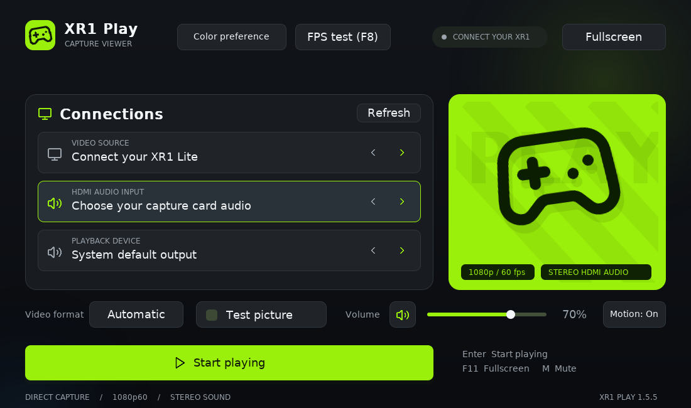

# XR1-L Play Windows Beta v1

Native **1080p60 preview with HDMI stereo audio** for EVGA XR1 Lite on Windows.

[Download Windows Beta v1](https://github.com/Jpooo/XR1-Play/releases/tag/windows-beta-v1)

## Connect and play

1. Extract the entire Windows ZIP, then open `XR1-Play.exe`. Keep its DLLs and assets folder together.
2. Connect Xbox/console HDMI OUT to XR1 Lite HDMI IN, then connect the card to USB 3 with a USB 3 data cable.
3. Set the console to **1080p, 60 Hz, SDR** and HDMI audio to **Stereo uncompressed**. Close other capture apps.
4. Choose the card's video source, its HDMI audio input and your speakers/headphones. Click **Start playing**.

Windows Settings must allow desktop camera and microphone access. Windows N needs the Media Feature Pack.

Use **Color preference** for Xbox green, PlayStation blue or Nintendo red. Your selection is saved.
**F/F11** toggles fullscreen, **M** mutes and **+/-** changes volume. **Tab** opens settings.
Click **FPS test** or press **F8** for a 30-second measurement; **Close** or F8 hides the test without stopping playback.

Beta v1 packages application build **1.5.5**. See [Windows setup](README-Windows.md) for details.

The working Linux AppImage is available in the separate [1.5.0 release](https://github.com/Jpooo/XR1-Play/releases/tag/v1.5.0).
