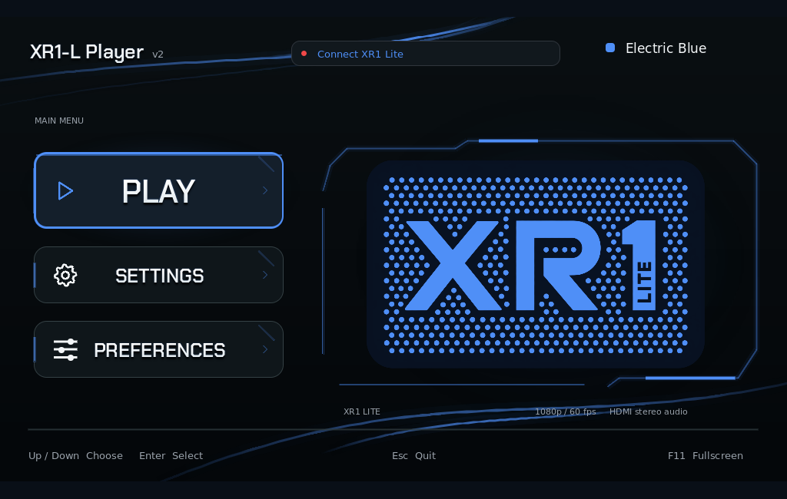
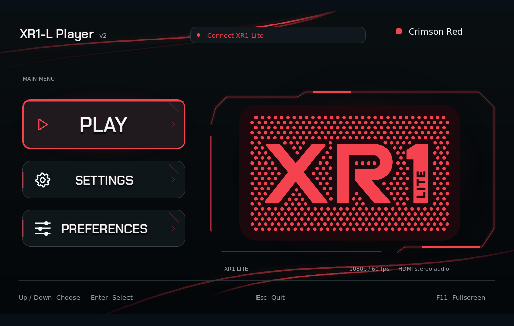

# XR1-L Player

**Beta V2 pre-release** · [Release notes](https://github.com/Jpooo/XR1-L-Player/releases/tag/beta-v2)

Native **1080p60 live preview and HDMI stereo audio** for EVGA XR1 Lite on Linux and Windows.

- [Linux ZIP](https://github.com/Jpooo/XR1-L-Player/releases/download/beta-v2/XR1-L-Player-Beta-V2-Linux-x86_64.zip) · [AppImage](https://github.com/Jpooo/XR1-L-Player/releases/download/beta-v2/XR1-L-Player-Beta-V2-Linux-x86_64.AppImage)
- [Windows x64 ZIP](https://github.com/Jpooo/XR1-L-Player/releases/download/beta-v2/XR1-L-Player-Beta-V2-Windows-x64.zip)

<table>
  <tr>
    <th>Neon Green</th>
    <th>Electric Blue</th>
    <th>Crimson Red</th>
  </tr>
  <tr>
    <td></td>
    <td></td>
    <td></td>
  </tr>
</table>

Choose your color in **Preferences**. Click a preview to view it full size.

## XR1 Lite system requirements

These requirements also apply when using XR1-L Player.

| CPU option | Required GPU |
| --- | --- |
| Intel i5-6XXX or better | NVIDIA GTX 1060 or AMD Radeon RX 560 XT or above |
| AMD Ryzen 3 1300X or better | NVIDIA GTX 1060 or AMD Radeon RX 560 XT or above |

- **RAM:** 8 GB minimum; 16 GB recommended.
- **USB 3.0 is required:** use a USB 3.0 port and USB 3.0 data cable.

## Connect and play

1. Connect console HDMI OUT to XR1 Lite HDMI IN, then connect the card directly to USB 3 with a USB 3 data cable.
2. Set the console to **1080p, 60 Hz, SDR** and HDMI audio to **Stereo uncompressed**. Close other capture apps.
3. **Linux:** extract the ZIP, make the AppImage executable, then open it. **Windows:** extract the whole ZIP and open `XR1-L-Player.exe`; keep the DLLs and assets together.
4. Open **Settings**, choose the card's video source, HDMI audio input and your speakers/headphones, then return and choose **Play**.

Use **Preferences** to save Neon Green, Electric Blue or Crimson Red and Motion On/Off.
**U** toggles optional FSR upscaling; **Shift+U** cycles optional sharpening (both default Off). FSR applies above 1080p; on Windows, enable it in Settings and restart first.
**F/F11** toggles fullscreen, **M** mutes, **+/-** changes volume and **Tab** opens settings / returns to video. Move the mouse during playback to reveal **Main menu** and playback controls. Use the mouse or arrows and Enter in menus; **Esc** goes back.
